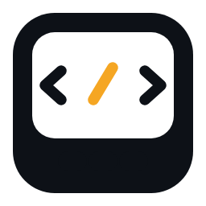
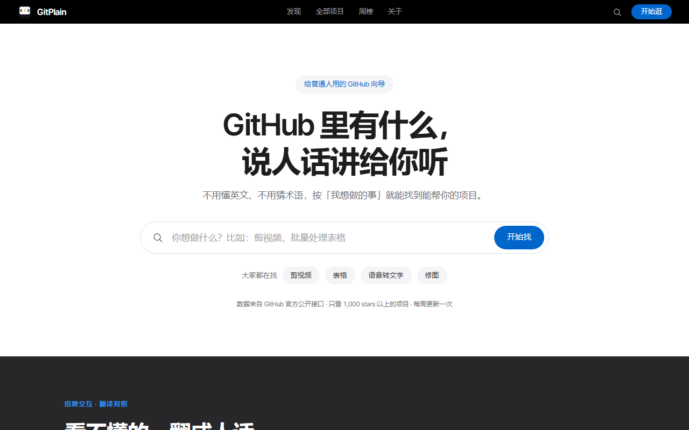

# GitPlain

<p align="center"></p>

**把 GitHub 项目翻译给普通人看。**

给「不懂编程、但开始用 AI 的人」看的 GitHub 项目站。
按「你想做的事」逛，不按编程语言分；每个项目都配一句大白话，点开直达原仓库。

- 不做推荐、不做编辑筛选 —— 只按真实数据排
- 不做榜单站 —— 追求实打实的数字，不追求好看

线上地址：https://www.gitplain.com

> 网站本身是没什么价值的，有价值的是可以帮助到不会编程的人玩转 GitHub。希望大家可以一起加入到这件有意义的事情！！！

---

## 现在有什么

| 项 | 数量 |
|---|---|
| 收录项目 | 65,856 个（>1,000 星） |
| 分类 | 25 个 |
| 项目详情页 | 5,692 个（>10,000 星，可被搜索引擎收录） |
| 周涨星数据 | 338 万条 star 事件（GH Archive 真实事件流） |
| 最近更新日期 | 直取 `pushed_at`，覆盖 99.998% |

<p align="center"></p>

## 页面结构

| 文件 | 作用 | 怎么来 |
|---|---|---|
| `index.html` | 首页：招牌对照、场景分类、本周 Top3 | `build.py` 生成（真实数据内联） |
| `browse.html` | 全部项目：搜索 / 分类 / 收藏 / 分页 | `build.py` 生成（首屏 10 条内联） |
| `weekly.html` | 本周涨星榜（100 条） | 手写，运行时读 `data/weekly.json` |
| `about.html` | 关于：是什么 / 为什么 / 数据从哪来 | 手写 |
| `contact.html` | 联系我们 | 手写 |
| `404.html` | 找不到页面 | 手写 |
| `repo/{owner}/{name}/` | 项目详情页 | `build.py` 生成 |

## 技术栈

**没有技术栈。** 纯静态：

- 原生 HTML / CSS / JavaScript（ES5 兼容，不用构建工具）
- 无框架、无后端、无数据库、无 CDN 外链
- 字体自托管（Inter Tight / JetBrains Mono 拉丁子集，共 76 KB），中文走系统字体
- 数据抓取用 Python 标准库，无第三方依赖

## 本地跑

```bash
python -m http.server 8899
```

或双击 `本地预览.bat`。打开 http://127.0.0.1:8899

> 直接双击 `index.html` 也能看首页，但搜索、分页要读 `data/*.json`，`file://` 下浏览器会拦，必须起本地服务。

## 构建

```bash
python build.py      # data_full.json → 首页 / 浏览页 / 5,692 详情页 / 分片 / sitemap
python deploy.py     # 打包到 dist/（18,936 文件 / 152.9 MB）
```

`build.py` 只生成数据驱动的页面，`weekly.html / about.html / contact.html / 404.html` 是手写的，重跑不会覆盖。
模板在 `templates/`（`index.html` / `browse.html` / `detail.html`），改版式改模板，不要改生成物。

## 部署

```bash
python deploy.py --upload    # 打包 + 上传 Cloudflare Pages
```

直接用 `wrangler` 直传，不走 GitHub 自动构建 —— 因为站点数据（`repo/`、`data/`）是生成物，进 git 会把仓库撑到 1 GB 以上。

**Cloudflare Pages 限制 20,000 文件**，当前 18,936，只剩 1,064 个余量。再加页面 / 详情页之前先合并分片。

## 数据更新（每周）

```bash
python fetch_stars_week.py --days 7   # 抓上周 star 事件（约 7 小时，63 GB 流量）
python fetch_pushed_at.py             # 刷新真实更新日期
python build.py                       # 重新生成全站
python deploy.py --upload             # 上线
```

`build.py` 在写新周榜前会把上一版 `data/weekly.json` 归档成 `data/weekly-last.json`。
周榜页的「上周」开关只在 `weekly-last.json` 存在时才显示，所以第一次更新后它才会出现，不会点出空页。

## 项目结构

```
index.html / browse.html / weekly.html / about.html / contact.html / 404.html
assets/          site.css, site.js, fonts/
templates/       index.html, browse.html, detail.html（build.py 用）
data/            page-N.json（分页分片）, f/（分类分片）, s/（搜索索引）, weekly.json, cats.json
repo/            5,692 个项目详情页
build.py         从 data_full.json 生成全站
deploy.py        打包 + 上传
fetch_*.py       数据抓取脚本
_archive/        历史脚本、旧版设计（不进版本控制、不部署）
```

## 设计规范

颜色、字号、间距、圆角全部定义在 `assets/site.css` 顶部的 `:root`：

- 动作蓝 `#0066CC`，深色区蓝 `#2997FF`
- 正文近黑 `#1D1D1F`，次要文本 `#6E6E73`
- 容器 1440 定宽 + 120 留白（窄屏 40 / 20）

改配色只改变量，不要在页面里写死色值。

## 授权

代码与数据：[MIT License](LICENSE)

自由使用、修改、分发、商用——没有任何限制，越多人用越好。

**商标例外**：「GitPlain」这个名字和 logo **不在** MIT 授权范围内。
你可以随意用代码和数据，但不能用「GitPlain」名称或 logo 标识你的衍生项目，也不能暗示与本站有关联。

## 数据来源与免责

- **项目数据**：来自 GitHub 公开 API，版权归各项目作者
- **周涨星数据**：来自 [GH Archive](https://www.gharchive.org/)（经 OpenDigger 镜像）
- **中文描述**：由仓库简介和 README 生成，可能存在偏差，**一切以原项目的英文说明为准**

本站保留每个项目的原始 GitHub 链接，所有流量最终导向原作者。

**如果你是项目作者，希望调整或移除本站对你项目的收录**：
请通过 [联系我们](https://www.gitplain.com/contact.html) 告知，我们会在 72 小时内处理。

## 贡献

欢迎 PR 和 Issue。

**两条红线**：
1. 转链接必须正确。每个项目的「在 GitHub 打开」必须指向正确的 `https://github.com/{owner}/{repo}`
2. 不做推荐、不做编辑筛选。只做翻译 + 直达，数据说话
